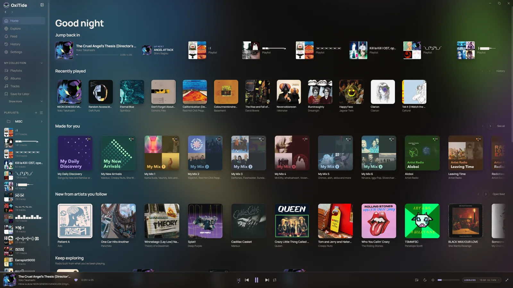
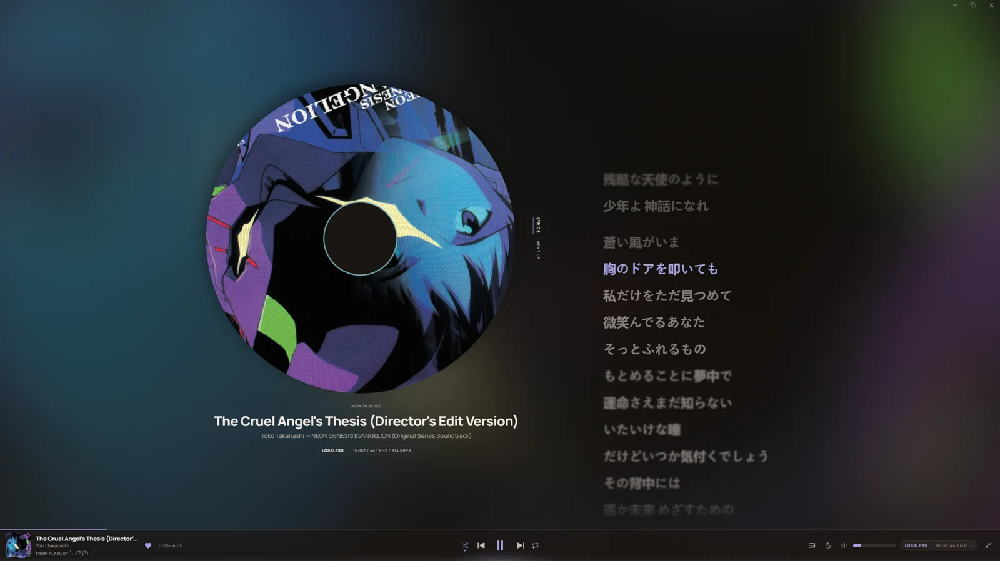
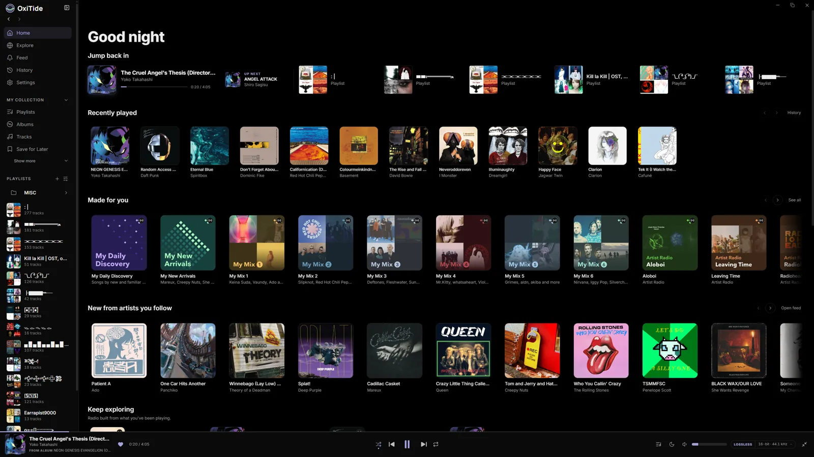
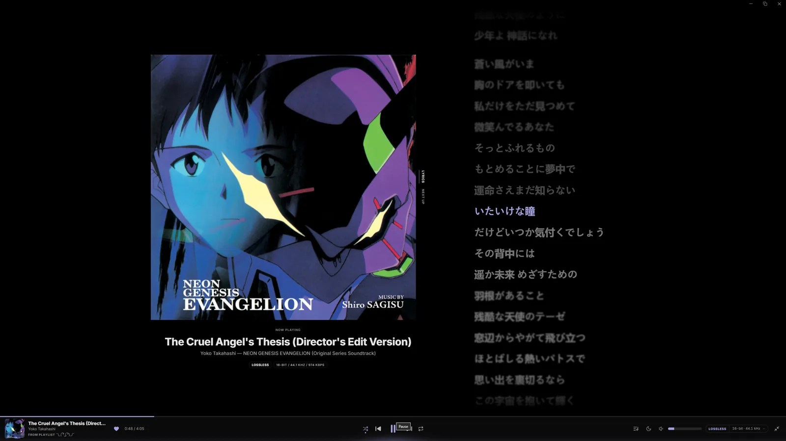
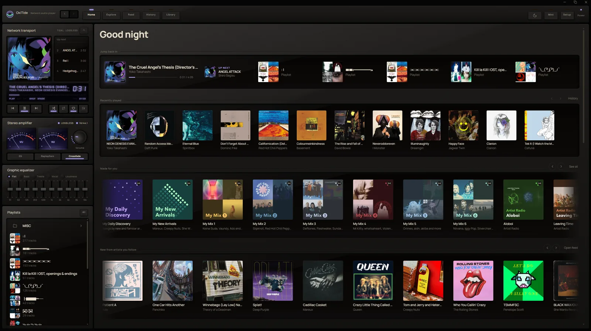
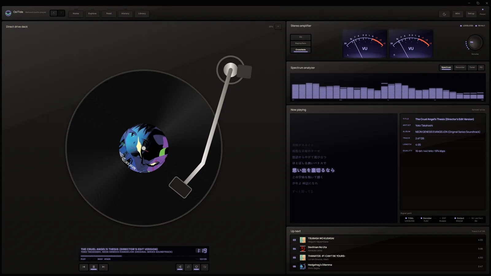
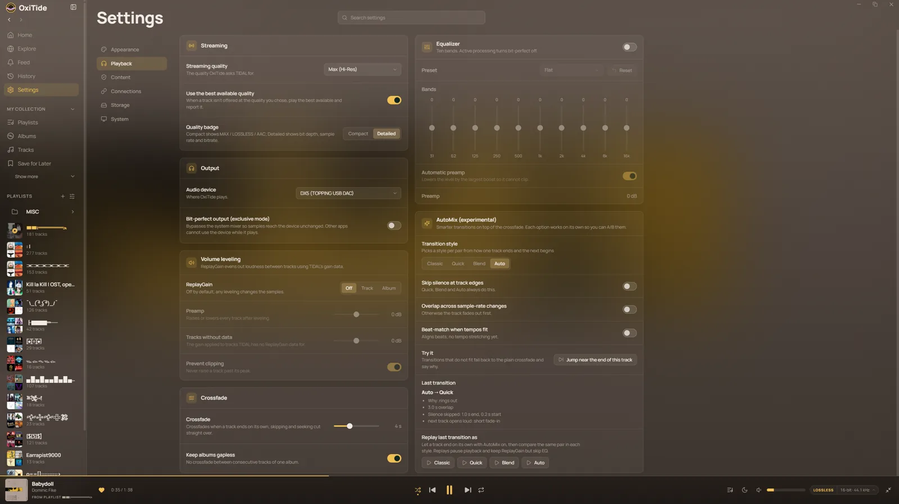
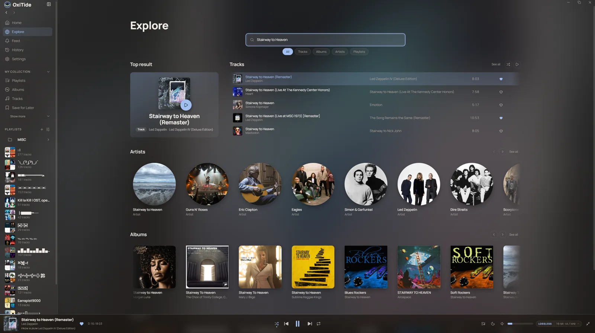
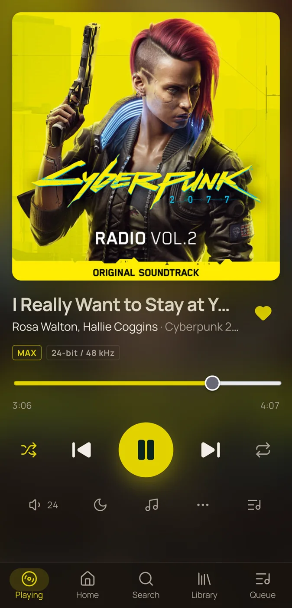
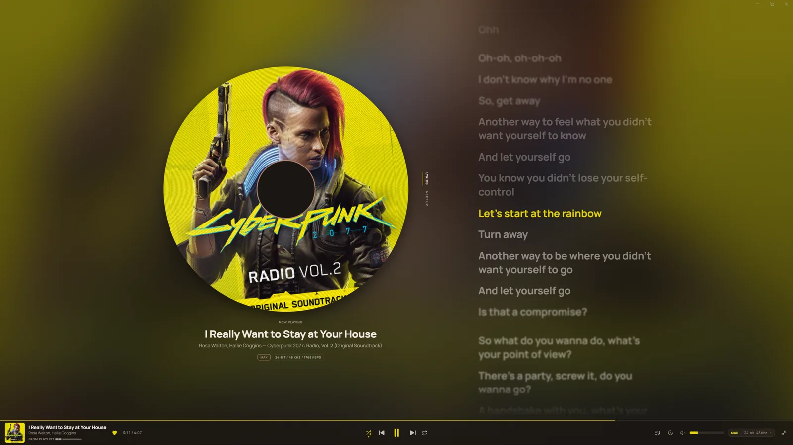

<p align="center">
  
</p>

<h1 align="center">OxiTide</h1>

<p align="center">
  A native, unofficial TIDAL desktop client with a bit-perfect audio engine, three visual modes,<br>
  and a phone remote. Built with Tauri 2, Rust and Svelte 5.
</p>

<p align="center">
  <a href="https://github.com/Zephulbr/OxiTide/actions/workflows/ci.yml"></a>
  <a href="https://github.com/Zephulbr/OxiTide/releases"></a>
  <a href="LICENSE"></a>
  
</p>

<p align="center">
  
</p>

> [!IMPORTANT]
> **OxiTide is an unofficial, third-party project. It is not affiliated with, endorsed by, or connected to TIDAL.**
> "TIDAL" is a trademark of its owner. A paid TIDAL subscription is required. OxiTide plays only what your
> own account can already stream. It does not bypass subscriptions, does not download or export songs,
> and does not circumvent DRM. Use it in line with TIDAL's terms.

## Why OxiTide

- **Bit-perfect output.** WASAPI exclusive mode on Windows, ASIO on Windows, and ALSA on Linux. When sound
  processing changes the signal, OxiTide tells you.
- **Sound tuning, all opt-in.** A 10-band EQ, ReplayGain, crossfade and AutoMix transitions. All are off by default.
- **Three looks.** Atmosphere, Studio and Hi-Fi Rack, each with light and dark themes, and settings for density,
  colour and more.
- **Phone remote.** Control playback, the queue and your library from a phone on your local network. Nothing to install on the phone.
- **Scrobbling built in.** Last.fm and ListenBrainz, each with its own switch, and a retry queue for offline plays.
- **Light on your machine.** A native Tauri shell. It goes idle when paused, releases the audio device after 30 seconds
  of pause, and reduces its memory use while hidden to the tray.
- **Private by default.** No telemetry, no account of its own, and your session tokens live in the OS keyring.

## Screenshots

<details>
<summary><b>Show screenshots</b></summary>

### Atmosphere

The default mode. Colour comes from the cover.

**Home**

<p align="center"></p>

**Now playing**

<p align="center"></p>

### Studio

Dense and still, in warm, neutral or black.

**Home**

<p align="center"></p>

**Now playing**

<p align="center"></p>

### Hi-Fi Rack

A hardware-style skin with needle and spectrum meters.

**Home**

<p align="center"></p>

**Now playing**

<p align="center"></p>

### Playback settings

<p align="center"></p>

### Search and Explore

<p align="center"></p>

### Phone remote

<table width="100%">
  <tr>
    <td width="35%" align="center" valign="middle"></td>
    <td width="65%" align="center" valign="middle"></td>
  </tr>
  <tr>
    <td align="center"><sub>Phone remote</sub></td>
    <td align="center"><sub>Desktop app, the same track</sub></td>
  </tr>
</table>

</details>

## Features

### Playback engine

- Own Rust audio engine with gapless playback, a queue with history, and a streaming cache that prefetches the next track.
- **Bit-perfect output.** Exclusive mode on WASAPI, or ASIO on Windows. If another app holds the device, exclusive mode
  falls back to shared output and tells you.
- **Sound processing, opt-in.** 10-band EQ, ReplayGain and crossfade. The UI shows which stage is active and when
  playback is no longer bit-perfect.
- **AutoMix (experimental).** Trims silence, overlaps tracks of different formats, and can beat-match transitions.
  Choose Classic, Quick, Blend or Auto.
- **Resilient.** If the network drops mid-track, playback waits and resumes where it stopped. Queue and position
  survive a restart.

### Customisable interface

- **Three modes:** Atmosphere (default), Studio (tones: warm, neutral, black) and Hi-Fi Rack (lamp colour and
  brightness, needle or spectrum meters).
- **Appearance:** light or dark theme, density, dynamic colour from cover art (or off), and row separators.
- **Accessibility:** keyboard navigation, focus handling, and reduced motion.

### Browse, search and discover

- **Home** has your personal shelves (recently played, and more) above TIDAL's editorial rows.
- **Explore** covers genres, moods and decades, plus "New to you" suggestions of artists you haven't heard.
- **Search** shows a top result, a track preview, and type filters, and corrects typos.
- Albums and artists with credits and album info, playlists, mixes and radio.
- Synced lyrics.

### Your library

- Favorite tracks, albums and artists. Create, rename and manage playlists.
- Drag tracks into playlists or the queue, and select several at once.
- Undo for removals from playlists, the queue and favorites.
- Listening history and stats, a sleep timer, and session restore.
- Optional filters for explicit and AI-generated content.

### Phone remote

- An opt-in web page on your phone that controls playback, the queue, search and your library.
- Pair by scanning a QR code shown on the desktop. The code works once and expires after five minutes.
- Works only from devices on your local network. Off by default.

### Desktop integration

- System tray with close-to-tray, and a native Windows 11 title bar with Snap Layouts.
- Windows taskbar thumbnail controls, and media keys through SMTC (Windows) or MPRIS (Linux).
- Discord Rich Presence (optional), and global hotkeys you define yourself.

### Scrobbling

- Last.fm and ListenBrainz, each with its own switch.
- Last.fm needs an API key, which is free to get from last.fm/api. Enter it in `config.toml` or the
  `OXITIDE_LASTFM_API_KEY` / `OXITIDE_LASTFM_API_SECRET` environment variables. ListenBrainz only needs your user token.
- Scrobbles queue while you're offline and send when the connection returns.

### Small touches

- **CatJam:** a cat beside the cover bobs to the beat. Beats are detected on your machine, and nothing about the track is sent anywhere.
- **oneko:** a cat that chases your cursor. Right-click it to summon its black cousin, kuroneko.
- Both can be turned off in Settings.

## What it isn't

- **Not a downloader.** There is no offline export. The playback cache is a buffer for smooth playback and gapless
  transitions, and you can clear it at any time.
- **Not affiliated with TIDAL.** It does not bypass subscriptions, and it does not play anything your account cannot stream.
- **No music video playback** and no native mobile app. The phone remote is a web page.
- **Windows first.** Linux is experimental (see [Platform status](#platform-status)). macOS is not planned.

## Install

Installers are published on the **Releases** page of the [GitHub](https://github.com/Zephulbr/OxiTide/releases)
repository (mirrored on [Codeberg](https://codeberg.org/Zephulbr/OxiTide)).

| Platform | Download | Notes |
|---|---|---|
| Windows 10/11 (x64) | `OxiTide_<version>_x64-setup.exe` (recommended) or the `.msi` | The `.exe` installs per user without admin rights. The `.msi` installs per machine. WebView2 is downloaded at install time if missing. |
| Linux (x86_64), experimental | `.AppImage` or `.deb`; AUR recipe in `packaging/aur/` | See [Platform status](#platform-status). |

**Windows SmartScreen.** The installers are not code-signed yet, so Windows shows *"Windows protected your PC"*
on first run. Choose **More info → Run anyway** after verifying the download.

**Verify downloads.** Each release lists SHA-256 hashes in `SHA256SUMS.txt`:

```powershell
Get-FileHash .\OxiTide_<version>_x64-setup.exe -Algorithm SHA256
```

**Updates.** Windows installs and the Linux AppImage check for a new release shortly after start and offer it in
**Settings → System → Updates**. Nothing downloads until you click. Updates are verified against a signing key built
into the app. Turn the startup check off in the same place. deb and AUR installs update through the package manager.

## Getting started

1. Launch OxiTide and choose **Log in with TIDAL**. Your browser opens TIDAL's login page. There is no embedded web view.
2. After you sign in, the browser hands control back to the app through a `tidal://` link and OxiTide unlocks on its own.
   If the browser doesn't open the app, use **Browser didn't open the app?**: sign in, then paste the address of the page
   you land on back into OxiTide.
3. Pick an output device and quality under **Settings → Playback**. Exclusive mode and ASIO are for bit-perfect output.
   Leave them off if you share the device with other apps.

**Keyboard shortcuts**

| Keys | Action |
|---|---|
| `Space` | Play / pause |
| `←` / `→` | Seek |
| `Shift+←` / `Shift+→` | Previous / next track |
| `↑` / `↓` | Volume |
| `M` | Mute |
| `Ctrl+F` or `/` | Search |
| `Alt+←` / `Alt+→` | Back / forward |
| `Esc` | Close the top-most panel |

Global hotkeys are defined in **Settings → System**.

## Privacy and security

- **No telemetry, no accounts of its own.** The only services OxiTide contacts are TIDAL (to function), and the
  optional services you turn on (GitHub for update checks, Last.fm, ListenBrainz, Discord, LRCLIB for lyrics).
- **Credentials** are stored in the OS keyring (Windows Credential Manager, or the Secret Service on Linux) and never logged.
- **Phone remote** is off by default. When on, it accepts only devices on your local network, requires QR pairing,
  and exposes a fixed allowlist of actions.
- **Data location:** everything lives under `%APPDATA%\OxiTide\`, or the XDG config directory on Linux.

The full list of network destinations and where each is controlled is in [`docs/privacy.md`](docs/privacy.md).

Found a vulnerability? Please report it privately to the maintainer rather than opening a public issue.

## Platform status

| | Windows | Linux (experimental) |
|---|---|---|
| Playback and library | Supported, primary target | Experimental |
| Output | WASAPI shared/exclusive, ASIO | ALSA |
| Media controls | SMTC and media keys | MPRIS |
| Credential storage | Credential Manager | Secret Service |
| Packaging | NSIS, MSI | AppImage, deb, AUR recipe |
| Testing | Daily use and owner smoke tests | Builds and tests pass under WSL2; bare-metal testing so far covers one KDE/Wayland machine |

macOS is not planned. ASIO output is merged, and its hardware smoke test is still pending.

## Build from source

Prerequisites: Rust stable (pinned by `rust-toolchain.toml`), Node 22.22+ or 24.15+ (the UI tests need it), and on
Linux the system packages in [`docs/linux-build.md`](docs/linux-build.md).

```bash
npm --prefix ui install        # also installs the Tauri CLI

npm --prefix ui run app:dev    # development: starts Vite, then the app window
npm --prefix ui run app:build  # installers under target/release/bundle/

cargo test --workspace
cargo clippy --workspace -- -D warnings
npm --prefix ui run check
npm --prefix ui test
```

> `cargo run -p oxitide-app` on its own fails with "localhost refused to connect": the debug build loads the Vite
> dev server, which must already be running. Use `app:dev`.

Continuous integration runs the same checks on Windows and Ubuntu 22.04 for every push and pull request.

## Project layout

| Path | What it is |
|---|---|
| `crates/oxitide-tidal` | Async TIDAL API client: PKCE login, token refresh, catalog, search, library. No UI dependencies. |
| `crates/oxitide-audio` | Playback engine: queue, decoding, cache, DSP, WASAPI / ASIO / ALSA output. |
| `crates/oxitide-app` | Tauri shell: commands, integrations, tray, phone-remote server, self-update. |
| `ui/` | Svelte 5 interface, including the phone-remote page (`ui/remote.html`). |
| `scripts/` | Icon generation, the performance harness, and release tooling. |
| `packaging/` | Linux packaging recipes (AUR). |
| `docs/` | Specs, plans, build and release guides. |

## Documentation

- [`docs/privacy.md`](docs/privacy.md): every network destination and how to control it.
- [`docs/release.md`](docs/release.md): how releases are cut and updates are signed.
- [`docs/linux-build.md`](docs/linux-build.md): Linux build environment and packaging.
- [`docs/superpowers/`](docs/superpowers/): design specs, implementation plans, the roadmap, and smoke-test notes.
- [`AGENTS.md`](AGENTS.md): architecture notes and conventions for contributors and coding agents.
- [`ui/design/DESIGN.md`](ui/design/DESIGN.md): the visual system behind the three modes.

## Contributing

Issues and pull requests are welcome. Before opening a pull request, run the four checks above; they are what CI runs.
Larger features start as a short spec under `docs/superpowers/specs/`. Read `AGENTS.md` for the conventions (Svelte 5
runes only, semantic design tokens, how Tauri commands are registered).

## Acknowledgements

Third-party attributions (vendored fonts, assets and Rust dependencies) are in
[`THIRD_PARTY_NOTICES.md`](THIRD_PARTY_NOTICES.md).

## License

[AGPL-3.0-or-later](LICENSE).
